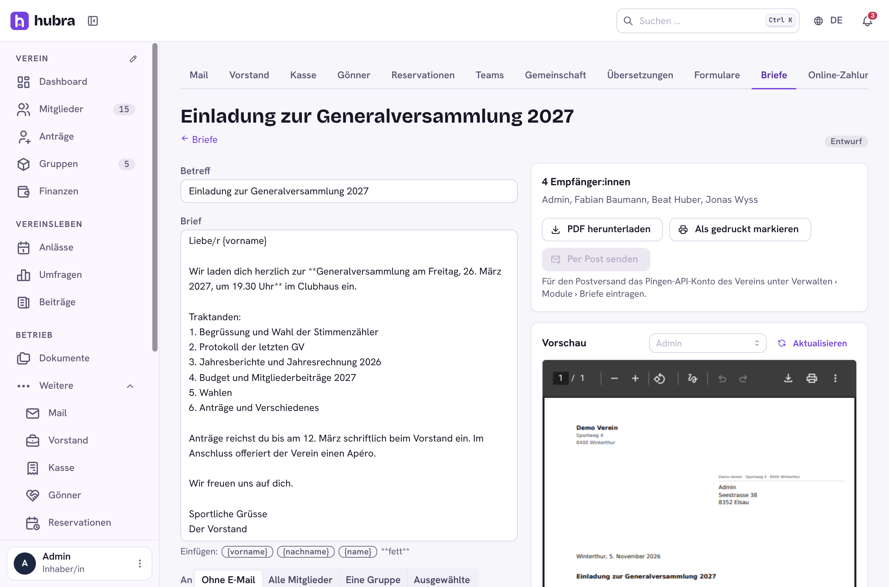
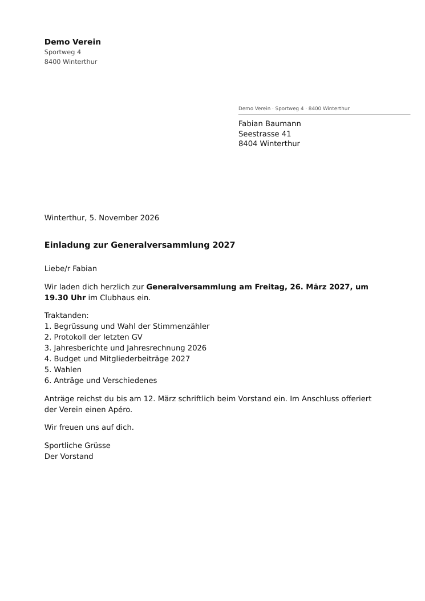
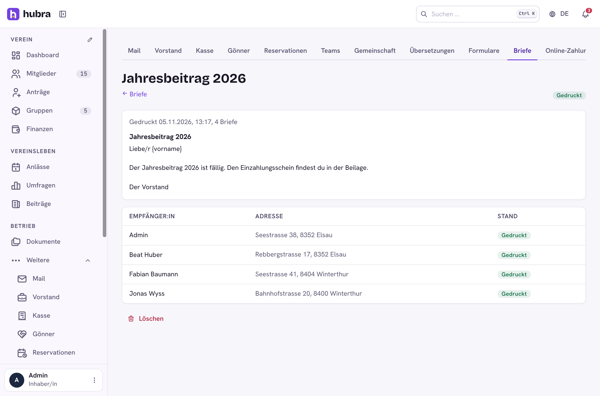

# Letters

[](https://github.com/hubra-app/hubra-plugin-letters/actions/workflows/release.yml?query=branch%3Amain) [](https://github.com/hubra-app/hubra-plugin-letters/releases/latest) [](LICENSE) [](https://buymeacoffee.com/bitsandbricks)

A plugin for [Hubra](https://hubra.club). Serial letters for members who read no e-mail: the board writes the letter once in Hubra, then prints one PDF for window envelopes or has [Pingen](https://www.pingen.com) print and post each letter.

**Version** 1.2.0 · **Works with** Hubra >=0.2.6,<1 · **Plugin id** `letters` · **Needs** the members module



## What it does

- **Write once, for everyone.** Subject and text with placeholders
  (`{vorname}`, `{nachname}`, `{name}`; `**bold**` works). An empty line
  starts a new paragraph.
- **Who gets it.** Members without a confirmed e-mail address (so club mail
  doesn't reach them), all members, one group, or members you pick. Only
  active members count. Members without a complete postal address are listed
  so the board can fix them first.
- **Window envelopes.** The letterhead and sender line come from the club's
  bank address (the bank details in the club settings). The recipient's address sits in the
  window: right (Swiss C5/C6, the default) or left (DIN 5008), set in the
  module's settings.
- **Print it yourself.** Hubra makes every letter into one PDF in the
  background, one page per member, and notifies you when it's ready (kept
  7 days). Download it, print it and mark the letter as printed. Hubra keeps
  who got it.
- **Or by post through Pingen.** Enter the club's own Pingen API client
  (client ID, secret, organisation ID) in the module's settings. Pressing
  **Send by post** queues one letter per member; a job hands them to Pingen
  every minute (25 per run, 3 tries each). Pingen prints, envelopes and posts
  them (B-Post or A-Post, black and white or colour). Failed letters show the
  reason and can be tried again. The staging switch sends to Pingen's test
  system, where nothing is printed.

Everything needs the permission `letters.letters.update` (Write letters,
print them and send them by post). Nothing leaves Hubra until someone
presses **Send by post**.

| | |
| --- | --- |
|  |  |

## Install

Platform admins install it from the Plugin catalogue in manage
(official Marketplace, <https://plugins.hubra.club/index.json>, signed with
the Hubra project key). Clubs then switch it on under Einstellungen → Module.

## Develop

Clone this repository into `plugins/letters` of a Hubra checkout. Its tests
then run with Hubra's (`cd app/backend && pytest ../../plugins/letters`), and
`npm run build:plugin` in `app/frontend` builds its frontend. The workflow
does the same against Hubra's `main` on every push and pull request.

## Releasing

Bump `version` in `plugin.yaml`, add a `## <version>` section to
`CHANGELOG.md` and merge. Then tag the merged commit on main and push the tag:

```sh
git switch main && git pull
git tag v<version> && git push origin v<version>
```

The workflow tests the plugin and builds its frontend, the `plugin-signing`
job signs it after your approval, and only then is the GitHub release
`v<version>` published, with `letters-<version>.zip` and its `.sha256` attached.
Files listed in `.releaseignore` stay out of the zip. Releases are immutable,
so a published version never changes: fix a bad one with a new version.

Source: <https://github.com/hubra-app/hubra-plugin-letters>
